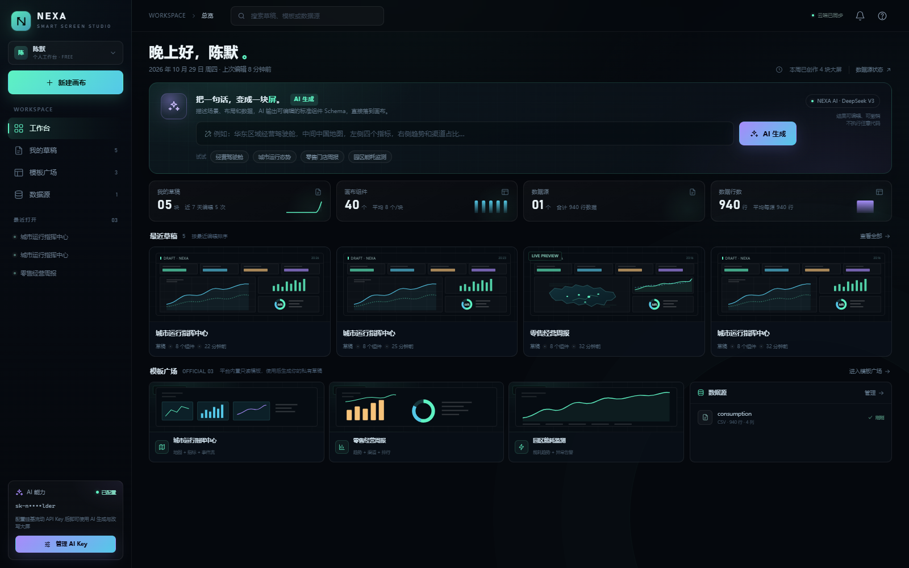
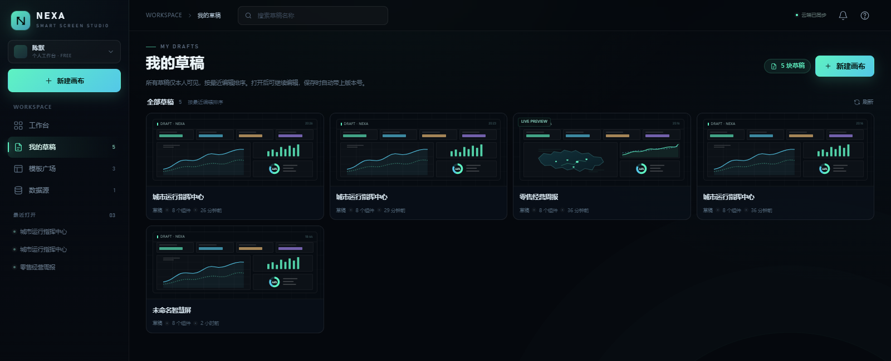
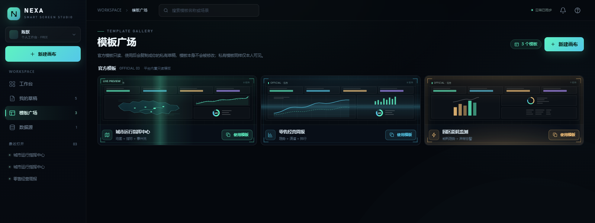
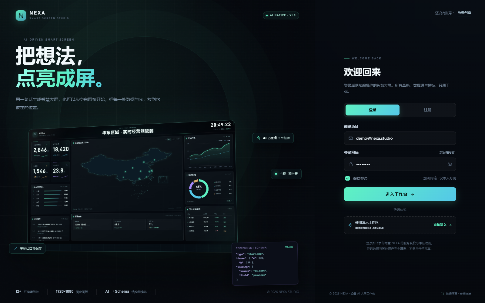
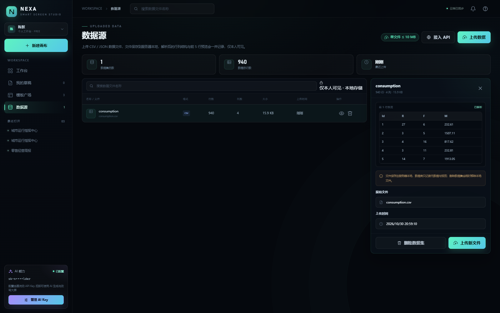
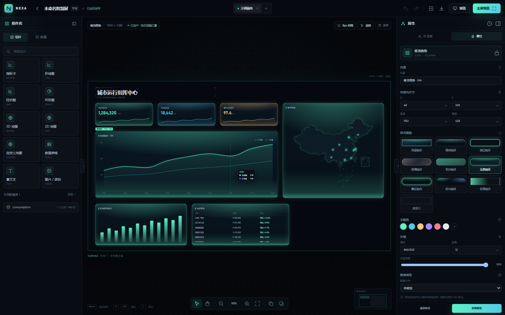
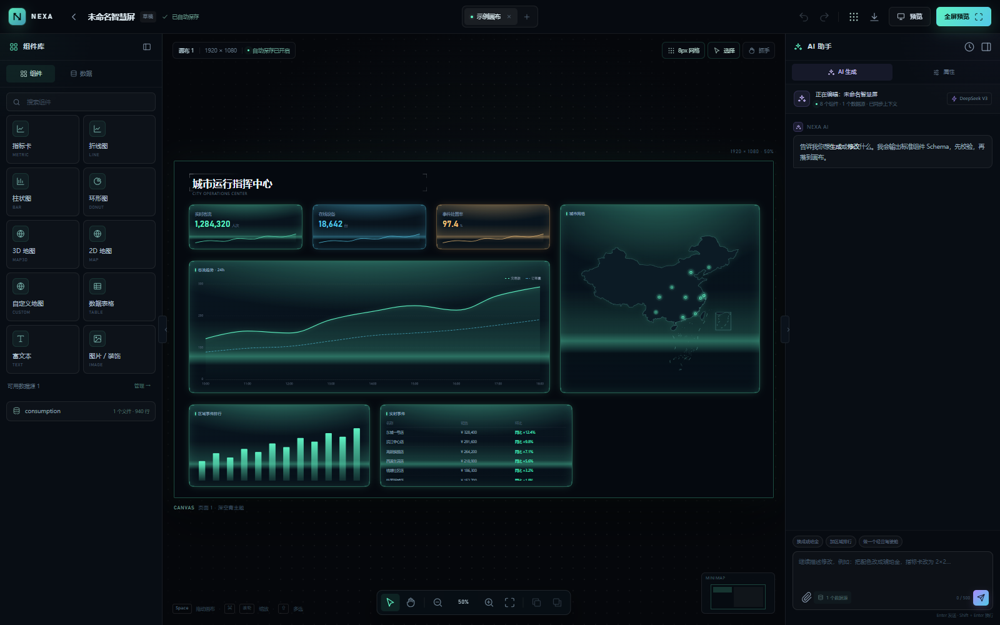
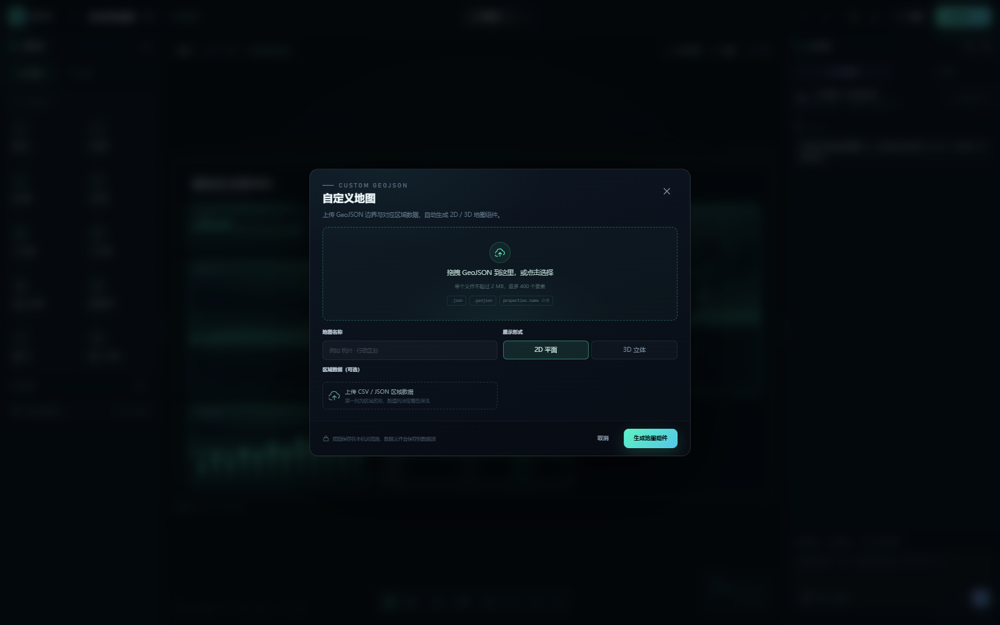
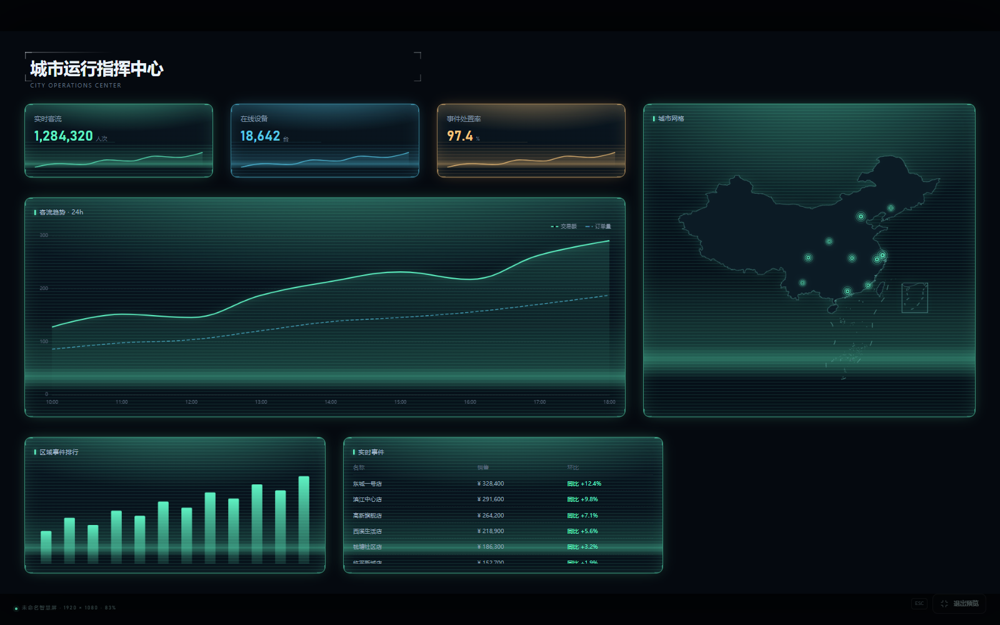

# NEXA 曜屏 · AI 数据可视化大屏平台

> 把一句话，变成一块屏。面向运营与业务场景的数据大屏搭建平台：AI 生成、可视化编辑、数据绑定、地图可视化、全屏预览与导出。

<p align="center">
  
</p>

## 核心功能

- **AI 生成大屏**：用一句话描述场景与布局，AI 输出标准组件 Schema 直接落到画布；支持整体替换、追加、覆盖修改，生成结果可撤销、可重新生成。
- **可视化编辑器**：组件拖动 / 缩放、画布缩放 50%–200%、抓手平移、8px 点阵网格、图层上下移、复制粘贴、撤销重做、0.7 秒自动保存、多草稿标签页。
- **组件库**：指标卡、折线图、柱状图、环形图、数据表、2D / 3D 地图（中国 / 四川底图）、自定义 GeoJSON 地图、文本与图片。
- **样式系统**：每个组件支持多套完整样式模板与多主题色，右侧属性面板实时调整。
- **数据源**：上传 CSV / JSON、从 API 地址导入、行列统计、前 5 行预览、连通性测试，内置实时波动测试接口。
- **模板广场**：官方模板一键生成私有草稿，舱体卡片与主题色动效。
- **草稿管理**：真实统计与最近草稿、就地重命名、删除确认、搜索、最近打开快捷入口。
- **预览与导出**：全屏预览自适应缩放（ESC 退出），一键导出 1920×1080 PNG。

## 界面截图

### 工作台与草稿

工作台汇总真实草稿、组件、数据源与数据行数，并提供 AI 一键生成入口。

<table>
  <tr>
    <td width="50%"></td>
    <td width="50%"></td>
  </tr>
  <tr>
    <td align="center">我的草稿：搜索、重命名、删除、继续编辑</td>
    <td align="center">模板广场：官方模板与主题化舱体动效</td>
  </tr>
</table>

### 登录与数据源

<table>
  <tr>
    <td width="50%"></td>
    <td width="50%"></td>
  </tr>
  <tr>
    <td align="center">登录 / 注册，演示账号一键进入</td>
    <td align="center">数据源上传、预览、测试与删除</td>
  </tr>
</table>

### 编辑器

画布、组件库与属性面板三栏布局，支持选中组件后调整样式模板、主题色、坐标与尺寸。

<p align="center">
  
</p>

<table>
  <tr>
    <td width="50%"></td>
    <td width="50%"></td>
  </tr>
  <tr>
    <td align="center">AI 助手：自然语言生成与改写组件</td>
    <td align="center">自定义 GeoJSON 底图一键生成 2D / 3D 地图</td>
  </tr>
</table>

### 全屏预览

<p align="center">
  
</p>

## 快速开始

环境要求：Node.js ≥ 22、pnpm 10、MySQL 8/9。

```bash
# 1. 安装依赖
pnpm install

# 2. 配置后端环境变量（填写 MySQL 连接，SMTP 可选）
cp apps/api/.env.example apps/api/.env

# 3. 初始化数据库表
pnpm --filter @nexa/api db:migrate

# 4. 写入演示账号（可选）
pnpm --filter @nexa/api db:seed

# 5. 启动前后端
pnpm dev:api   # 后端 http://localhost:3000
pnpm dev:web   # 前端 http://localhost:5173
```

打开 <http://localhost:5173>，演示账号：`demo@nexa.studio` / `nexa2026`。

AI 能力需要在侧边栏「AI 能力」中配置硅基流动 API Key，Key 仅保存在浏览器 `localStorage`，不会上传服务器。

## 技术架构

| 层   | 技术                                                                            |
| ---- | ------------------------------------------------------------------------------- |
| 前端 | Vue 3、Vue Router、Pinia、Vite、TypeScript、ECharts + ECharts-GL、html-to-image |
| 后端 | Fastify 5、Drizzle ORM、MySQL、Zod、Nodemailer（注册验证码）                    |
| 共享 | `packages/schema` 统一维护画布、组件、AI 响应 Schema 与错误码                   |

```text
apps/
├── web/                  # Vue 前端：工作台、编辑器、预览、数据源、模板广场
└── api/                  # Fastify 后端：认证、草稿、数据源、上传
packages/
└── schema/               # 前后端共享的 Zod Schema 与类型
docs/
└── screenshots/          # README 界面截图
```

## 常用脚本

| 命令                                 | 说明                       |
| ------------------------------------ | -------------------------- |
| `pnpm dev:web`                       | 启动前端开发服务器（5173） |
| `pnpm dev:api`                       | 启动后端开发服务器（3000） |
| `pnpm build`                         | 构建前端生产产物           |
| `pnpm typecheck`                     | 全仓类型检查               |
| `pnpm --filter @nexa/api db:migrate` | 执行数据库迁移             |
| `pnpm --filter @nexa/api db:seed`    | 写入演示账号               |
| `pnpm --filter @nexa/api db:studio`  | 打开 Drizzle Studio        |

## 使用说明

- 数据源文件保存在后端 `apps/api/uploads`，仅本人可见；支持 CSV / JSON，单文件 ≤ 10MB。
- 自定义地图底图保存在浏览器 `localStorage`（最多 12 个，GeoJSON ≤ 2MB、≤ 400 个要素），换设备或清缓存后会降级为中国底图。
- 3D 地图建议使用省级底图，区县级要素过多会影响帧率。
- 地图数据绑定需保证区域名称与底图 `properties.name` 完全一致才能正确着色。
- 截图中数据来自演示账号的本地演示数据。
